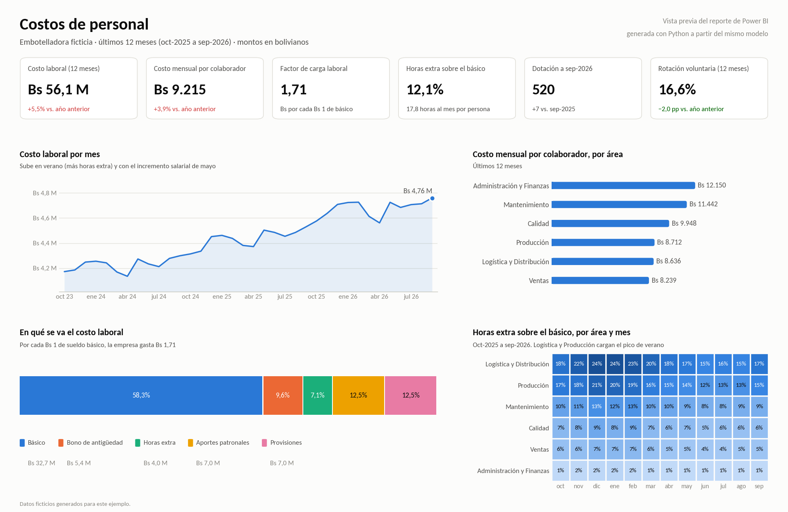
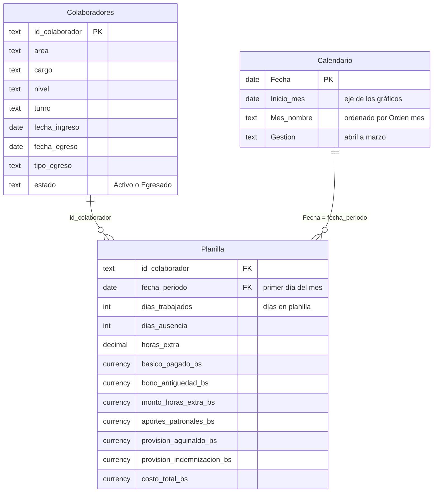

# ¿Cuánto cuesta realmente la planilla y qué parte se puede gestionar?

**Reporte de costos de personal para Power BI.** Incluye el modelo estrella, la carga en Power Query, 27 medidas DAX y una guía para armar el reporte paso a paso. Muestra cuánto cuesta la gente, por qué sube el costo y dónde se concentran las horas extra.



> **Vista previa y datos ficticios.** La imagen se genera con Python (`vista_previa.py`) usando las mismas definiciones que las medidas DAX, así que también sirve para verificar los números del reporte. Los datos corresponden a una embotelladora ficticia de unos 500 colaboradores, entre octubre de 2023 y septiembre de 2026, y se generan con `generar_datos.py`. No describen a ninguna empresa real.

## Resultados (últimos 12 meses)

| Pregunta | Respuesta |
|---|---|
| ¿Cuánto cuesta la gente? | **Bs 56,1 millones**, unos **Bs 9.215 al mes por colaborador**. |
| ¿Cuánto cuesta cada Bs 1 de sueldo básico? | **Bs 1,71.** El básico es el 58% del costo; los aportes patronales y las provisiones de aguinaldo e indemnización suman otro 25%. |
| ¿Por qué subió? | El costo creció **5,5%** contra el año anterior, pero la dotación solo pasó de 513 a 520 personas. La mayor parte viene del costo por persona (**+3,9%**), en línea con el incremento salarial de mayo. |
| ¿Qué parte se puede gestionar? | Las **horas extra**: Bs 4,0 millones al año, que con aportes y provisiones llegan a **Bs 5,3 millones**. El **80%** se paga en Logística y Producción, que tienen el 63% de la dotación. En Logística llegan al **24% del básico** en diciembre y enero. |
| ¿Qué hacer primero? | **Planificar la temporada alta.** De noviembre a febrero, Logística y Producción pagaron **Bs 1,27 millones** en horas extra. Cada hora extra cuesta el doble que una hora normal, así que conviene evaluar personal de temporada o un turno adicional para esos meses. |

## El modelo

Una tabla de hechos con la planilla mensual y dos dimensiones.



`Colaboradores` no se relaciona con `Calendario`. Las renuncias y los egresos se cuentan con `TREATAS` sobre la fecha de egreso, así el mismo filtro de fechas sirve para el costo y para la rotación.

## Medidas principales

| Medida | Qué responde |
|---|---|
| Costo Laboral | Todo lo que paga la empresa: total ganado + aportes patronales + provisiones. |
| Factor de Carga Laboral | Cuántos Bs cuesta cada Bs 1 de sueldo básico. |
| Costo Mensual por Colaborador | Costo de una persona a tiempo completo durante un mes. Divide por meses-persona, no por la dotación de cierre. |
| Costo Últimos 12 Meses, Costo Acumulado Gestión | Ventana móvil de 12 meses y acumulado desde abril (la gestión va de abril a marzo). |
| Var % vs Mes Anterior, Var % Interanual | Variaciones con `DATEADD` y `SAMEPERIODLASTYEAR`. |
| % Horas Extra sobre Básico, Horas Extra por Colaborador | Peso y volumen de las horas extra. |
| % Ausentismo | Días de ausencia sobre días en planilla. |
| Dotación, Dotación Promedio | Personas en planilla al cierre del período y promedio de cada mes. |
| Renuncias, Rotación Voluntaria % | Renuncias del período sobre la dotación promedio, también anualizada. |

Las 27 medidas están comentadas en [`powerbi/medidas.dax`](powerbi/medidas.dax), con el formato sugerido para cada una.

## Cómo armar el reporte en Power BI Desktop

1. **Descargar el repositorio.** *Code > Download ZIP* y descomprimirlo.
2. **Parámetro con la ruta.** *Inicio > Transformar datos* abre el editor de Power Query. Ahí, *Administrar parámetros > Nuevo parámetro*: nombre `RutaDatos`, tipo Texto y, como valor, la ruta de la carpeta `datos` terminada en barra (por ejemplo `C:\Proyectos\dashboard-costos-personal-powerbi\datos\`).
3. **Consultas.** En el mismo editor, *Nuevo origen > Consulta en blanco > Editor avanzado*: pegar la consulta `Colaboradores` de [`powerbi/consultas_power_query.m`](powerbi/consultas_power_query.m) y repetir con `Planilla`. Después, *Cerrar y aplicar*.
4. **Calendario.** *Modelado > Nueva tabla* y pegar [`powerbi/calendario.dax`](powerbi/calendario.dax). Marcarla como tabla de fechas (columna `Fecha`) y ordenar `Mes nombre` por `Orden mes`.
5. **Relaciones.** En la vista de modelo, las dos de varios a uno y con dirección de filtro única:
   - `Planilla[id_colaborador]` → `Colaboradores[id_colaborador]`
   - `Planilla[fecha_periodo]` → `Calendario[Fecha]`
6. **Medidas.** Crear la tabla vacía `Medidas` (*Inicio > Especificar datos > Cargar*). En la vista de consultas DAX (*DAX query view*), pegar todo [`powerbi/medidas.dax`](powerbi/medidas.dax) y ejecutarlo: el resultado tiene que coincidir con los valores de control de abajo. Después, *Actualizar modelo con cambios* (*Update model with changes*) guarda las 27 medidas en la tabla `Medidas`.
7. **Visuales de la página principal:**
   - Segmentadores: `Calendario[Fecha]` (entre fechas), `Colaboradores[area]` y `Colaboradores[nivel]`.
   - Seis tarjetas: Costo Laboral, Costo Mensual por Colaborador, Factor de Carga Laboral, % Horas Extra sobre Básico, Dotación y Rotación Voluntaria %.
   - Gráfico de líneas: Costo Laboral por `Calendario[Inicio mes]`.
   - Barras: Costo Mensual por Colaborador por `Colaboradores[area]`.
   - Barra 100% apilada: Básico Pagado, Bono Antigüedad, Monto Horas Extra, Aportes Patronales y Provisiones.
   - Matriz: `Colaboradores[area]` en filas, `Calendario[Mes nombre]` en columnas y % Horas Extra sobre Básico con formato condicional de fondo.

### Valores de control

Con el filtro de fechas del 1/10/2025 al 30/9/2026, el mismo que usa la consulta de `medidas.dax`:

| Medida | Valor |
|---|---:|
| Costo Laboral | 56.139.481 |
| Costo Año Anterior | 53.214.878 |
| Var % Interanual | 5,5% |
| Costo Acumulado Gestión (abril a septiembre de 2026) | 28.153.318 |
| Costo Mensual por Colaborador | 9.215 |
| Factor de Carga Laboral | 1,71 |
| % Horas Extra sobre Básico | 12,1% |
| Horas Extra por Colaborador | 17,8 |
| % Ausentismo | 1,6% |
| Dotación | 520 |
| Dotación Promedio | 516,8 |
| Egresos | 114 |
| Renuncias | 86 |
| Rotación Voluntaria % | 16,6% |

`python vista_previa.py` calcula las mismas cifras con pandas, sin Power BI.

## Supuestos de la planilla

La planilla sigue la lógica de una planilla boliviana, simplificada para el ejemplo:

| Concepto | Supuesto |
|---|---|
| Aportes patronales | 16,71% del total ganado: seguro de salud 10%, riesgo profesional 1,71%, aporte patronal solidario 3% y vivienda 2%. |
| Aguinaldo e indemnización | Provisión mensual de 1/12 del total ganado para cada uno. |
| Horas extra | Al doble: haber básico / 240 horas × 2. |
| Bono de antigüedad | Porcentaje según los años de servicio (5% desde los 2 años hasta 50% desde los 25) sobre 3 salarios mínimos. El salario mínimo se fija en Bs 2.750. |
| Incremento salarial | 4% cada mayo. |
| Gestión | De abril a marzo, como en las empresas industriales. |

## Estructura

```
├── powerbi/
│   ├── consultas_power_query.m   carga de los CSV en Power Query
│   ├── calendario.dax            tabla calendario con la gestión de abril a marzo
│   └── medidas.dax               27 medidas y la consulta de valores de control
├── datos/
│   ├── colaboradores.csv         una fila por persona (dimensión)
│   └── planilla_mensual.csv      una fila por persona y mes (hechos)
├── vista_previa.py               genera img/vista_previa.png y los valores de control
├── generar_datos.py              genera los datos ficticios (semilla fija)
├── graficos.py                   estilo de los gráficos
├── requirements.txt
└── img/
    └── vista_previa.png
```

## Cómo correr la parte de Python

```bash
pip install -r requirements.txt
python generar_datos.py    # opcional: los datos ya están en datos/
python vista_previa.py     # regenera la imagen e imprime los valores de control
```

**Herramientas:** Power BI · Power Query (M) · DAX · Python · pandas · matplotlib

Proyecto relacionado: [¿Cuánto le cuesta la rotación a una embotelladora?](https://github.com/karmyvicenteasbun-sys/costo-rotacion-people-analytics) analiza la misma empresa ficticia.

---

### English summary

This is a payroll cost report for Power BI, built on a fictional bottling company with about 500 employees and synthetic data from October 2023 to September 2026.
- The repo includes a star schema, Power Query (M) scripts to load the data and 27 documented DAX measures: time intelligence, headcount, and turnover counted with `TREATAS`.
- A step-by-step guide explains how to build the report, with control values to check that the model is right.
- A Python script renders the preview and recomputes every figure with pandas.

Key findings: every Bs 1 of base salary costs the company Bs 1.71, and labor cost grew 5.5% year over year while headcount barely moved. Overtime costs Bs 5.3 million a year including payroll taxes and provisions, and 80% of it is paid in Logistics and Production during the summer peak.

---

Vicente Asbun · [LinkedIn](https://www.linkedin.com/in/vicente-antonio-asbun-karmy-30aa19164/)
